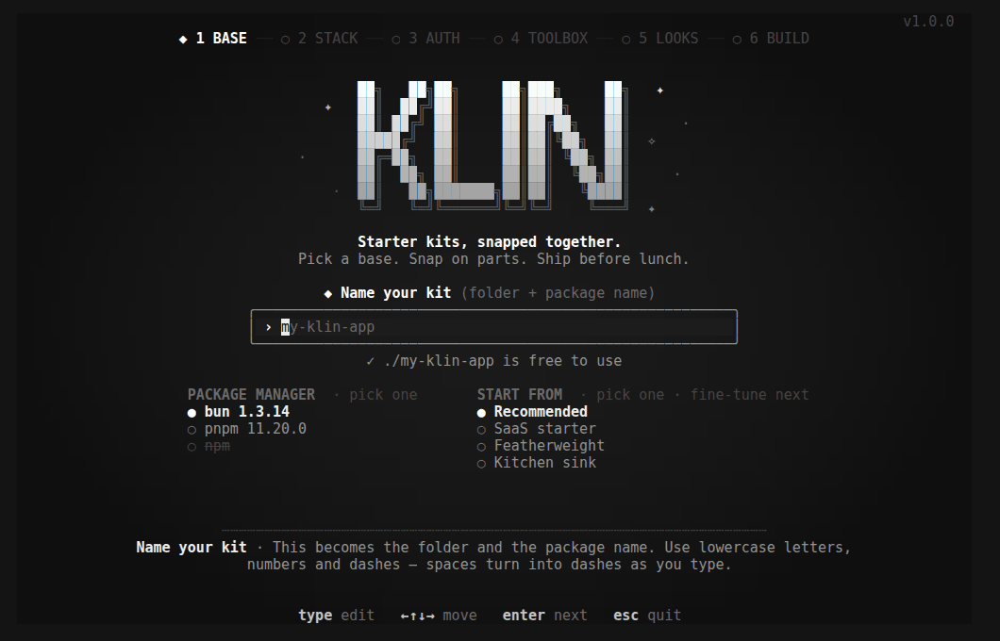

<div align="center">

<picture>
  <source media="(prefers-color-scheme: dark)" srcset="./brand/logo/klin-lockup-white.svg" />
  
</picture>

**A spotless full-stack TypeScript starter.**
NestJS or plain Express/Fastify · Better Auth · Prisma · Vite + TanStack Router or Next.js · TanStack Query/Form · shadcn/ui · Turborepo

[](https://www.npmjs.com/package/create-klin)
[](https://github.com/nata-t/klin/actions/workflows/ci.yml)
[](./LICENSE)
[](#requirements)

```bash
npm create klin@latest
```



</div>

---

- [Quick start](#quick-start)
- [Requirements](#requirements)
- [Why klin](#why-klin)
- [What you get](#what-you-get)
- [Create a project](#create-a-project): [the wizard](#the-wizard), [presets](#presets), [flags](#flags)
- [Your new project](#your-new-project)
- [Grow it](#grow-it): [`generate`](#klin-generate), [`add` / `remove`](#klin-add--klin-remove), [`doctor`](#klin-doctor), [`list`](#klin-list), [`upgrade`](#klin-upgrade)
- [How it works](#how-it-works)
- [Troubleshooting](#troubleshooting)
- [Develop klin](#develop-klin)

## Quick start

```bash
bun create klin my-app          # or: npm create klin@latest · pnpm create klin
cd my-app
bun run db:up                   # Postgres (and Redis/storage, if picked) in Docker
bun run db:migrate              # create the tables
bun run db:seed                 # demo@example.com / demo-password-123
bun run dev                     # web :5173 · API :3000 · Prisma Studio :5555
```

Open <http://localhost:5173> and sign in with the demo account. The wizard
prints these steps for your choices when it finishes. With the `minimal`
preset (SQLite, no Docker) you can skip `db:up`.

## Requirements

| | |
| --- | --- |
| **Node.js** | 22.12 or newer |
| **Package manager** | bun (the default), pnpm or npm. `bun create`, `pnpm create` and `npm create` each default to themselves. |
| **git** | optional: used to create the repository and make the first commit |
| **Docker** | only for local services: Postgres or MySQL, Redis (background jobs) and RustFS (S3-compatible uploads). SQLite without jobs or uploads needs nothing. |

On Linux, your user must be able to reach Docker (usually by joining the
`docker` group). If it can't, the next steps and `klin doctor` show the
one-time fix for your OS. See [Troubleshooting](#troubleshooting).

## Why klin

Most projects spend their first month building the same thing: auth, an API
skeleton, validation, a dashboard shell, CI, Docker. klin hands you that month,
already wired together, and then stays useful after day one.

**The opinion:** one Zod schema should describe a piece of data *everywhere*.
It validates the form, validates the request, shapes the response and gives
both apps their types (`z.infer`). klin is built around that idea. Schemas live
in `packages/validators`; a NestJS API turns them into DTOs with
[nestjs-zod](https://github.com/BenLorantfy/nestjs-zod), a plain Express or
Fastify API parses with them directly, and the generator writes whole features
on top of it.

**It's a good fit for** SaaS products, internal tools, dashboards and API-backed
apps where a separate backend is a feature, not overhead.

**It's not for** static sites, or projects that want everything — data access
included — inside one Next.js app. klin can render the web app with Next.js
(server-rendered pages, SEO for your public pages), but the API stays its own
app. If you'd rather have no API at all, use a framework built for that.

## What you get

| | |
| --- | --- |
| **Auth** (Better Auth) | sign up/in/out, verify email, forgot/reset password, sessions page · Google · GitHub · magic links · 2FA (TOTP + backup codes) · passkeys · guarded routes on both sides |
| **API** | **NestJS 12** (on Express or Fastify) with a global auth guard, `@Public()` `@Roles()` `@CurrentUser()` and nestjs-zod DTOs — or **plain Express 5 / Fastify 5** with auth middleware and the same schemas · one error envelope · pino logs with request ids · CORS, helmet and rate limiting (each optional) · health check · seed script |
| **Web** (React 19 on Vite or Next.js) | public / auth / dashboard layouts · **Vite:** TanStack Router with `beforeLoad` guards · **Next.js 16:** the App Router, signed-in pages checked on the server (`proxy.ts` + layouts) and `/api` rewritten to the API · typed API client + query-key conventions · TanStack Form + shadcn/ui form kit (in `apps/web` or a shared `packages/ui`, `pnpm ui:add <component>`) · 18 shadcn theme colors · dark mode · error, 404 & loading states |
| **Monorepo** | Turborepo with caching and `db:*` tasks · `dev` in the split-pane TUI: Prisma client generated first, then web, API and Prisma Studio side by side · shared TS/ESLint/Prettier configs · husky + lint-staged + commitlint · Vitest + Playwright |
| **Ops** | Docker Compose for local services · production Dockerfiles (API, and the web app on nginx or Next's standalone server) · GitHub Actions · Renovate · `.env` with generated secrets |
| **Optional modules** | organizations & RBAC · admin dashboard · API keys · transactional email (Resend + React Email) · file uploads (S3/R2 presigned) · background jobs (BullMQ) · i18n (English to start) |
| **Docs** | `packages/docs` in every project: getting started, architecture, the shared-validators flow, add-a-feature walkthrough, UI & theming, testing, deployment, upgrading |

Pick Postgres, MySQL or SQLite, and bun, pnpm or npm. Unused code is stripped,
not left behind as dead flags.

## Create a project

```bash
npm create klin@latest                       # interactive
bun create klin my-app                       # interactive, name filled in
bunx create-klin my-app --preset saas -y     # no questions
```

### The wizard

In a terminal, `create-klin` opens a full-screen, grayscale wizard — a step
indicator on top, the small klin egg beside the version in the corner, everything
centered — six steps, each a page of text chips you snap on and off:

1. **Base** — name your kit (validated live: `✓ ./my-app is free to use`), package manager, a preset to start from
2. **Stack** — NestJS or plain · Express or Fastify · Postgres, MySQL or SQLite · Vite or Next.js for the web app
3. **Auth** — sign-in methods and Better Auth power-ups
4. **Toolbox** — CORS, Helmet, rate limiting (on by default, with a warning if you switch one off), email, uploads, jobs, i18n, Docker, CI
5. **Looks** — where shadcn/ui lives (`apps/web` or `packages/ui`) and one of shadcn's 18 theme colors
6. **Build** — review, then build with live progress

Keys: <kbd>↑</kbd><kbd>↓</kbd><kbd>←</kbd><kbd>→</kbd> move, <kbd>space</kbd>
snaps a chip on or off, <kbd>enter</kbd> goes to the next step, <kbd>esc</kbd>
goes back. The highlighted option is explained at the bottom of the page.
Problems show in red and risky choices in amber; everything else stays gray.

Then it scaffolds the project, strips what you didn't pick, writes `.env` with
fresh secrets, runs `git init`, installs dependencies, generates the Prisma
client, makes the first commit, and prints your next steps.

With `--yes` (or in CI) it skips the wizard and uses the flags, the preset and
the defaults.

### Presets

| Preset | What's in it |
| --- | --- |
| `recommended` (default) | NestJS on Express, email & password, Postgres in Docker, every API safeguard, GitHub Actions CI |
| `saas` | adds Google, GitHub and 2FA sign-in, organizations & RBAC, the admin dashboard, email, uploads and background jobs |
| `minimal` | plain Fastify, email & password on SQLite, no Docker needed |
| `everything` | every module on, so you can tour the whole kit and delete what you don't need |

A preset is a starting point: flags and the wizard change anything on top of it.

### Flags

| Flag | Values |
| --- | --- |
| `[name]` | the folder and package name (`my-app`) |
| `--preset <id>` | `recommended` · `saas` · `minimal` · `everything` |
| `--backend <name>` | `nest` · `plain` |
| `--server <name>` | `express` · `fastify` |
| `--db <name>` | `postgres` · `mysql` · `sqlite` |
| `--web <name>` | `vite` · `next` (picked once, at create) |
| `--auth <list>` | `password,google,github,magic-link,two-factor,passkey` |
| `--plugins <list>` | `organizations,admin,api-keys` or `none` |
| `--security <list>` | `cors,helmet,rate-limit` or `none` |
| `--extras <list>` | `email,uploads,queues,i18n,docker,ci` or `none` |
| `--components <where>` | `apps-web` · `packages-ui` |
| `--accent <color>` | `neutral` · `amber` · `blue` · `cyan` · `emerald` · `fuchsia` · `green` · `indigo` · `lime` · `orange` · `pink` · `purple` · `red` · `rose` · `sky` · `teal` · `violet` · `yellow` |
| `--pm <name>` | `bun` (default) · `pnpm` · `npm` |
| `--template <src>` | `./folder` or `github:you/your-template[#branch]` ([custom templates](#custom-templates)) |
| `-y`, `--yes` | accept the defaults, ask nothing |
| `--dry-run` | list what would be created, write nothing |
| `--no-install` · `--no-git` · `--no-banner` | skip the install · skip git · skip the logo |
| `--force` | use a folder that isn't empty — **its contents are deleted first** |

```bash
pnpm create klin my-app --preset saas --backend nest --server fastify --db postgres --pm pnpm
bunx create-klin my-app --backend plain --server express --auth password,google,passkey --plugins organizations --extras email,docker,ci -y
bunx create-klin my-app --web next --db sqlite -y
```

## Your new project

```
my-app/
├─ apps/
│  ├─ api/                  the API: NestJS, or plain Express / Fastify (:3000)
│  └─ web/                  the web app: Vite + TanStack Router, or Next.js (:5173)
├─ packages/
│  ├─ validators/           Zod schemas shared by both apps — data shapes start here
│  ├─ db/                   Prisma schema (split by domain), client, migrations
│  ├─ auth/                 Better Auth server config and typed client
│  ├─ env/                  the server environment, validated on boot
│  ├─ ui/                   shadcn/ui components and theme (with packages/ui)
│  ├─ email/                React Email templates (with email)
│  ├─ docs/                 guides for this codebase
│  └─ eslint-config/ · typescript-config/
├─ docker-compose.yml       local Postgres/MySQL, Redis, RustFS (with Docker)
├─ docker-compose.prod.yml  the production stack (with Docker)
├─ .env                     generated with fresh secrets; .env.example documents every variable
├─ klin.json                what klin generated: version and options (used by add/remove/upgrade)
└─ AGENTS.md                conventions for AI coding assistants
```

| Script | |
| --- | --- |
| `dev` | web, API and Prisma Studio side by side in Turborepo's TUI |
| `build` · `start` | production builds, and running them |
| `lint` · `typecheck` · `test` · `test:e2e` | checks: ESLint, TypeScript, Vitest, Playwright |
| `db:up` · `db:down` | start / stop the local services in Docker |
| `db:migrate` · `db:deploy` · `db:push` · `db:reset` · `db:seed` · `db:studio` | the database |
| `ui:add <component>` | add a shadcn/ui component |
| `klin …` | the klin CLI, at the version that made the project |

Each project ships its own docs in `packages/docs`, including deployment
(Docker on one machine, images anywhere, or platform builds).

## Grow it

Inside a project, run the CLI through your package manager: `bun run klin …`,
`pnpm klin …` or `npx klin …`. It's a dev dependency, pinned to the version
that made the project, so it works offline.

### `klin generate`

```bash
pnpm klin generate                            # asks what to make and what to call it
pnpm klin generate resource billing/invoice   # model + schemas + API + page
pnpm klin generate backend billing/invoice    # controller, service, DTOs, module
pnpm klin generate frontend billing/invoice   # page, route, query hooks, form
```

| Kind (alias) | Writes |
| --- | --- |
| `resource` (`r`) | Zod schemas, a Prisma model, the API module and the web feature |
| `backend` (`b`, `api`) | a Nest controller with the five REST endpoints, service, nestjs-zod DTOs and a module registered in `app.module.ts` — or plain Express/Fastify routes and a service — plus the schemas |
| `frontend` (`f`, `web`) | a page, its route (an App Router `page.tsx` with Next.js, also added to `proxy.ts`'s guarded pages), TanStack Query hooks, a form and a sidebar entry — plus the schemas |

**The files and the wiring, not your schema:** one example `name` field shows
where yours go; backend-only services answer 501 until you fill them in.
Slashes make folders (`billing/invoice` goes in a `billing/` folder in every
layer). Everything typechecks and lints as generated. Names that would clash
with existing schemas, models or modules are refused before anything is
written.

| Flag | |
| --- | --- |
| `--url <path>` | serve on `/api/<path>` and `/<path>` instead of the folder path |
| `--plural <word>` | when the guessed plural is wrong (`criterion` → `criteria`) |
| `--no-model` | skip the Prisma model (the service is left for you to fill in) |
| `--no-validation` | skip `packages/validators` (the schemas already exist) |
| `--no-route` · `--no-nav` | skip the page's route · skip the sidebar entry |
| `--dry-run` · `--force` | show the plan only · overwrite generated files |
| `--backend-dir` · `--frontend-dir` · `--validation-dir` · `--model-dir <dir>` | put this run's files in another folder (inside `apps/api/src`, `apps/web/src`, `packages/validators/src` or `packages/db/prisma`) |

To change where each layer goes for good, run `klin generate paths` (or pick
"Change default paths" in `klin generate`); the project's defaults are saved in
`klin.json`, and `--reset` brings back klin's.

### `klin add` / `klin remove`

```bash
pnpm klin add organizations email   # bolt modules on later
pnpm klin remove email              # …or take them out
```

Pass ids from `klin list`. klin renders the template with your old options and
with the new ones, then merges the difference into your code: files you never
touched are replaced, files you edited are 3-way merged, and only real
conflicts get markers. The web framework is picked once and can't be switched.

### `klin doctor`

Checks your toolchain, `.env`, database, Redis and storage reachability, Docker
access, ports, generated code, pending migrations and dependency version drift,
and says how to fix what it finds.

### `klin list`

Every module and choice, with its id, and which ones your project has on.

### `klin upgrade`

*Experimental.* Merges template improvements from a newer create-klin into your
project, the same 3-way way as `add`/`remove`. Commit first.

## How it works

### The template is a real project

[`template/`](./template) is a complete monorepo with every module switched on.
Code that belongs to a module is marked with comments, in whatever syntax the
file uses:

```ts
import { organization } from "better-auth/plugins/organization" // klin:only organizations

// klin:if postgres
provider: "postgresql",
// klin:elif sqlite
//? provider: "sqlite",
// klin:endif
```

The CLI evaluates those markers against your answers and strips the rest.
Modules, prompts, presets and strip rules are all declared in
[`template/klin.template.json`](./template/klin.template.json).

### Custom templates

The CLI is a generic engine, so **you can fork the template**, add your own
modules, and point the CLI at it:

```bash
npm create klin@latest my-app -- --template github:you/your-klin-template
npm create klin@latest my-app -- --template ./path/to/template
```

See [CONTRIBUTING.md](./CONTRIBUTING.md#template-authoring) for the marker
reference.

### Upgrades without a framework package

Scaffolded code can't be `npm update`d, so klin records what it generated in
`klin.json` (version + options) and uses **3-way merges** for every later change:

- `klin add` / `klin remove` render the template with your old options and
  with the new ones, then merge the difference into your code.
- `klin upgrade` does the same between the template version you started from
  and the latest one.

Dependencies stay fresh with Renovate, in the template here and in every
generated project (grouped updates, a 3-day release-age gate, automerge for
safe ones).

## Troubleshooting

**Docker says "permission denied" (Linux).** Your user isn't in the `docker`
group yet. Once: `sudo usermod -aG docker $USER`, then `newgrp docker` (or log
out and back in). On macOS and Windows, quit and reopen Docker Desktop.

**Docker isn't running.** Linux: `sudo systemctl enable --now docker`. macOS:
`open -a Docker`. Windows: start Docker Desktop.

**The install failed.** The project is still written; fix the cause (network,
registry, disk space) and run `bun install` (or your package manager's install)
inside it.

**A port is taken.** The API's port is `API_PORT` in `.env`; the web app's is
in `apps/web/package.json`. `klin doctor` tells you which one is busy.

**Conflict markers after `klin add` / `remove` / `upgrade`.** They mean you
and the template changed the same lines. Resolve them like a git merge
conflict, then run `typecheck`.

Anything else: run `klin doctor`, then
[open an issue](https://github.com/nata-t/klin/issues) with its output.

## Develop klin

```bash
pnpm install
pnpm build              # CLI → packages/create-klin/dist, template copied in
pnpm test               # engine, merge, rendering matrix
pnpm playground saas    # render + install a preset into .playground/saas
pnpm site:dev           # the website and docs (website/), on :4321
node packages/create-klin/dist/index.js --help
```

See [CONTRIBUTING.md](./CONTRIBUTING.md) for the layout, the marker reference
and the release process. Changes are tracked in
[CHANGELOG.md](./packages/create-klin/CHANGELOG.md).

## License

[MIT](./LICENSE)
