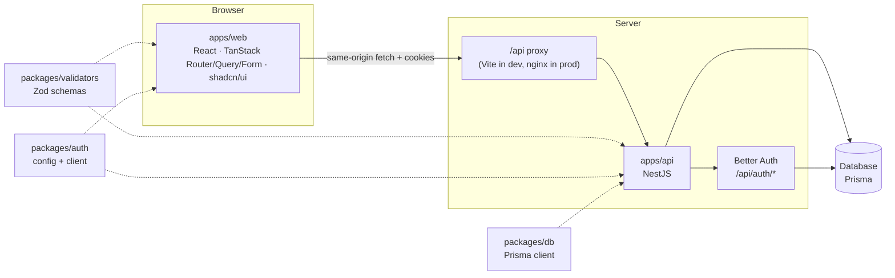
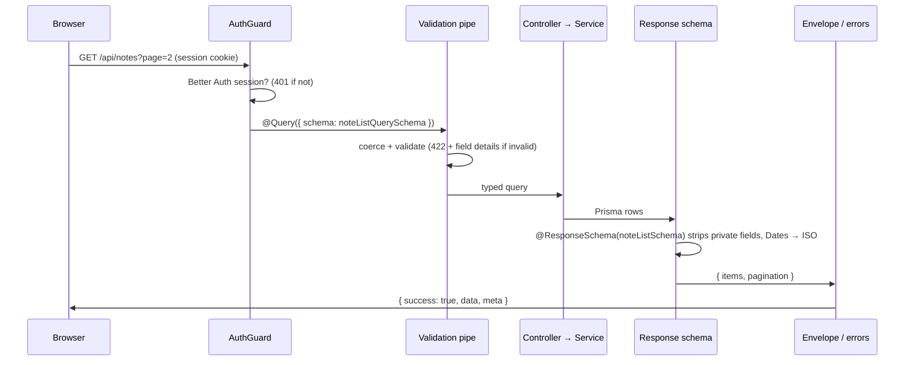

# Architecture

## The big picture



- **The browser only talks to its own origin.** `/api/*` is forwarded to Nest
  (Vite's dev server does it locally, nginx in the production image), so auth
  cookies are first-party and there's no CORS dance.
- **Workspace packages ship TypeScript source.** Vite compiles them for the web
  app; the API is bundled with tsup, which compiles them into one file.
- **There's one source of truth for each concern.** Data shapes live in
  `packages/validators`, the database schema in `packages/db`, auth config in
  `packages/auth`, and server env in `packages/env`.

## A request, start to finish



Errors take the same route in reverse: `ApiExceptionFilter` turns anything
thrown (HttpExceptions, validation failures, Prisma unique/not-found errors,
bugs) into `{ success: false, error: { code, message, details? }, meta }`. The
web client (`apps/web/src/lib/api-client.ts`) unwraps successes and throws an
`ApiError` for failures, which React Query toasts automatically.

## Auth

- **Server:** `packages/auth/src/auth.ts` configures Better Auth (providers,
  plugins, session lifetime, cookie attributes). The API mounts it at
  `/api/auth/*` through `@thallesp/nestjs-better-auth`.
- **Guards:** every API route needs a session by default. Opt out or tighten it
  per route or controller:

  ```ts
  @Public()                 // no session needed
  @Optional()               // session optional
  @Roles("admin")           // user.role must match
  <!-- klin:if organizations -->
  @RequireActiveOrg()       // an organization must be active
  @OrgRoles(["owner", "admin"])
  @MemberHasPermission({ permissions: { project: ["delete"] } })
  <!-- klin:endif -->
  ```

  Read the user with `@CurrentUser()` (or `@CurrentUser("id")`), or the whole
  session with `@CurrentSession()`.
- **Web:** the session lives in React Query (`lib/session.ts`). Route guards
  are plain `beforeLoad` functions: `_app.tsx` sends signed-out visitors to
  `/sign-in?redirect=…`; `_auth.tsx` sends signed-in users to the dashboard.
- **Cookies:** `HttpOnly`, `SameSite=Lax`, and `Secure` in production. Because
  of the same-origin proxy this works unchanged in dev and prod. Deploying the
  API on a different site? See [deployment](./deployment.md#separate-origins).

## Web app conventions

| Thing | Where | Pattern |
| --- | --- | --- |
| Routes | `src/routes/**` | File-based. `_public`, `_auth`, `_app` are layouts. Keep route files thin. |
| Feature code | `src/features/<feature>/` | `api.ts` (query keys + hooks), components, pages |
| Query keys | `features/*/api.ts` | `noteKeys.all / lists() / list(q) / detail(id)` — invalidate by prefix |
| Forms | `src/components/form` | `useAppForm` + a schema from `@repo/validators` + `field.TextField` etc. |
| UI kit | `src/components/ui` | shadcn/ui (Base UI). Add more with `pnpm dlx shadcn@latest add …` in `apps/web` |
| Errors / 404 / loading | `src/components` | Router defaults: `RouteError`, `NotFound`, `PageLoader` |
| Page titles | route `staticData: { title }` | Shown in the header and the browser tab |

## API conventions

| Thing | Where |
| --- | --- |
| Feature modules | `src/modules/<feature>/{module,controller,service}.ts` |
| Cross-cutting | `src/common` — auth decorators, pagination helpers, filter, interceptor, pipe |
| Database access | inject `PrismaService` (it *is* the shared Prisma client) |
| Logging | pino via nestjs-pino. `new Logger(Context)` as usual; every request gets an `x-request-id` |
| Rate limiting | `@nestjs/throttler`, 120 req/min/IP globally; tune with `@Throttle()` / `@SkipThrottle()` |
| Security headers | helmet |
| Health | `GET /api/health` checks the database |
