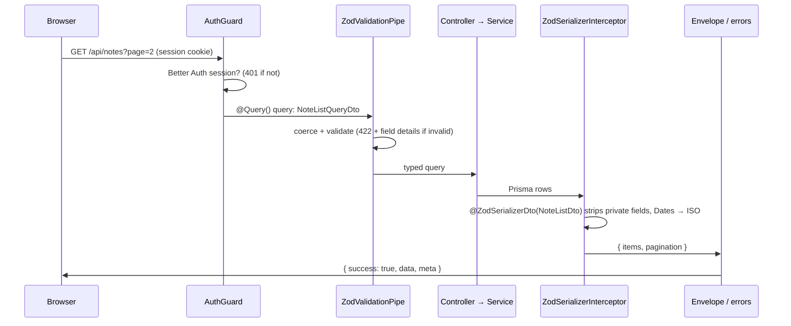
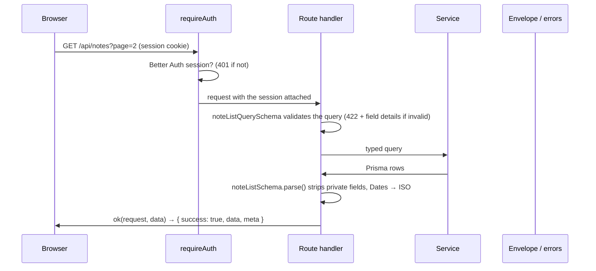

# Architecture

## The big picture

```mermaid
flowchart LR
  subgraph Browser
    <!-- klin:if next -->
    web["apps/web<br/>Next.js · TanStack Query/Form · shadcn/ui"]
    <!-- klin:else -->
    web["apps/web<br/>React · TanStack Router/Query/Form · shadcn/ui"]
    <!-- klin:endif -->
  end
  subgraph Server
    <!-- klin:if next -->
    proxy["/api rewrite<br/>(the Next.js server)"]
    <!-- klin:else -->
    proxy["/api proxy<br/>(Vite in dev, nginx in prod)"]
    <!-- klin:endif -->
    <!-- klin:if nest-express -->
    api["apps/api<br/>NestJS on Express"]
    <!-- klin:elif nest-fastify -->
    api["apps/api<br/>NestJS on Fastify"]
    <!-- klin:elif express -->
    api["apps/api<br/>Express"]
    <!-- klin:else -->
    api["apps/api<br/>Fastify"]
    <!-- klin:endif -->
    ba["Better Auth<br/>/api/auth/*"]
  end
  db[("Database<br/>Prisma")]

  web -- "same-origin fetch + cookies" --> proxy --> api
  api --> ba
  api --> db
  ba --> db

  validators["packages/validators<br/>Zod schemas"] -.-> web
  validators -.-> api
  authpkg["packages/auth<br/>config + client"] -.-> web
  authpkg -.-> api
  dbpkg["packages/db<br/>Prisma client"] -.-> api
```

<!-- klin:if next -->
- **The browser only talks to its own origin.** `/api/*` is forwarded to the API
  (a rewrite in `next.config.ts`, in dev and in production; the Docker stack's
  nginx sends it straight to the API), so auth cookies are first-party and
  there's no CORS dance.
- **Workspace packages ship TypeScript source.** Next.js compiles them for the
  web app (`transpilePackages`); the API is bundled with tsup, which compiles
  them into one file.
- **Next.js renders the pages, the API owns the data.** Server code in
  `apps/web` only checks the session (with the visitor's cookie); everything
  else goes through the API, like it does from the browser.
<!-- klin:else -->
- **The browser only talks to its own origin.** `/api/*` is forwarded to the API
  (Vite's dev server does it locally, nginx in the production image), so auth
  cookies are first-party and there's no CORS dance.
- **Workspace packages ship TypeScript source.** Vite compiles them for the web
  app; the API is bundled with tsup, which compiles them into one file.
<!-- klin:endif -->
- **There's one source of truth for each concern.** Data shapes live in
  `packages/validators`, the database schema in `packages/db`, auth config in
  `packages/auth`, and server env in `packages/env`.

## A request, start to finish

<!-- klin:if nest -->


Errors take the same route in reverse: `ApiExceptionFilter` turns anything
thrown (HttpExceptions, nestjs-zod validation failures, Prisma unique/not-found
errors, bugs) into `{ success: false, error: { code, message, details? }, meta }`.
<!-- klin:else -->


Errors take the same route in reverse: the error handler (`lib/http.ts`'s
`toErrorShape`) turns anything thrown (`HttpError`s, Zod validation failures,
Prisma unique/not-found errors, bugs) into
`{ success: false, error: { code, message, details? }, meta }`.
<!-- klin:endif -->

The web client (`apps/web/src/lib/api-client.ts`) unwraps successes and throws an
`ApiError` for failures, which React Query toasts automatically.

## Auth

- **Server:** `packages/auth/src/auth.ts` configures Better Auth (providers,
  plugins, session lifetime, cookie attributes). The API mounts it at
  <!-- klin:if nest -->
  `/api/auth/*` through `@thallesp/nestjs-better-auth`.
  <!-- klin:elif express -->
  `/api/auth/*` with `toNodeHandler(auth)` (before the JSON body parser).
  <!-- klin:else -->
  `/api/auth/*` as a Fastify route that hands requests to `auth.handler`.
  <!-- klin:endif -->
<!-- klin:if nest -->
- **Guards:** every API route needs a session by default. Opt out or tighten it
  per route or controller:

  ```ts
  @Public()                 // no session needed
  @Optional()               // session optional
  @Roles("admin")           // user.role must match
  <!-- klin:if organizations -->
  @RequireActiveOrg()       // an organization must be active
  @OrgRoles(["owner", "admin"])
  @MemberHasPermission({ permissions: { project: ["delete"] } })
  <!-- klin:endif -->
  ```

  Read the user with `@CurrentUser()` (or `@CurrentUser("id")`), or the whole
  session with `@CurrentSession()`.
<!-- klin:else -->
- **Guards:** routes opt in to auth with the helpers in
  <!-- klin:if express -->
  `src/middleware/auth.ts` — plain Express middleware:

  ```ts
  router.use(requireAuth)                  // 401 without a session
  router.use(requireAuth, requireRole("admin"))
  <!-- klin:if organizations -->
  router.use(requireActiveOrg)             // an organization must be active
  router.get("/billing", requireOrgRole("owner", "admin"), …)
  router.get("/projects", requirePermission({ project: ["read"] }), …)
  <!-- klin:endif -->
  ```

  After `requireAuth`, the session is `res.locals.auth` (`.user`, `.session`).
  <!-- klin:else -->
  `src/hooks/auth.ts` — Fastify hooks:

  ```ts
  app.addHook("preHandler", requireAuth)   // 401 without a session
  app.addHook("preHandler", requireRole("admin"))
  <!-- klin:if organizations -->
  app.addHook("preHandler", requireActiveOrg)
  app.get("/billing", { preHandler: requireOrgRole("owner", "admin") }, …)
  app.get("/projects", { preHandler: requirePermission({ project: ["read"] }) }, …)
  <!-- klin:endif -->
  ```

  After `requireAuth`, the session is `request.auth` (`.user`, `.session`).
  <!-- klin:endif -->
<!-- klin:endif -->
<!-- klin:if next -->
- **Web:** two checks before a signed-in page renders. `src/proxy.ts` sends
  visitors without a session cookie to `/sign-in?redirect=…` (it only looks for
  the cookie); then the `(app)` layout asks the API whether the session is real
  (`lib/server-session.ts`) and hands it to React Query (`lib/session.ts`), so
  the shell renders with the user straight away. The `(auth)` layout sends
  signed-in users to the dashboard.
<!-- klin:else -->
- **Web:** the session lives in React Query (`lib/session.ts`). Route guards
  are plain `beforeLoad` functions: `_app.tsx` sends signed-out visitors to
  `/sign-in?redirect=…`; `_auth.tsx` sends signed-in users to the dashboard.
<!-- klin:endif -->
- **Cookies:** `HttpOnly`, `SameSite=Lax`, and `Secure` in production. Because
  of the same-origin proxy this works unchanged in dev and prod. Deploying the
  API on a different site? See [deployment](./deployment.md#separate-origins). <!-- klin:only vite -->
  API somewhere else? See [deployment](./deployment.md#api-on-another-host). <!-- klin:only next -->

## Web app conventions

| Thing | Where | Pattern |
| --- | --- | --- |
<!-- klin:if next -->
| Pages | `src/app/**` | The App Router. `(public)`, `(auth)` and `(app)` are route groups with their own layouts. Keep `page.tsx` thin: metadata plus a component from `src/features` |
| Server vs browser | `page.tsx` and layouts run on the server | Feature pages start with `"use client"` — hooks, TanStack Query and forms live there |
<!-- klin:else -->
| Routes | `src/routes/**` | File-based. `_public`, `_auth`, `_app` are layouts. Keep route files thin. |
<!-- klin:endif -->
| Feature code | `src/features/<feature>/` | `api.ts` (query keys + hooks), components, pages |
| Query keys | `features/*/api.ts` | `noteKeys.all / lists() / list(q) / detail(id)` — invalidate by prefix |
| Forms | `src/components/form` | `useAppForm` + a schema from `@repo/validators` + `field.TextField` etc. |
<!-- klin:if packages-ui -->
| UI kit | `packages/ui` (`@repo/ui/components/*`) | shadcn/ui (Base UI). Add more with `pnpm ui:add <name>` — see [UI & theming](./ui.md) |
<!-- klin:else -->
| UI kit | `src/components/ui` | shadcn/ui (Base UI). Add more with `pnpm ui:add <name>` — see [UI & theming](./ui.md) |
<!-- klin:endif -->
<!-- klin:if next -->
| Errors / 404 / loading | `src/components` | `app/error.tsx` and `app/not-found.tsx` render `RouteError` and `NotFound`; `PageLoader` for waits |
| Page titles | `export const metadata = { title }` in `page.tsx` | The browser tab; the header shows the sidebar entry you're in |
<!-- klin:else -->
| Errors / 404 / loading | `src/components` | Router defaults: `RouteError`, `NotFound`, `PageLoader` |
| Page titles | route `staticData: { title }` | Shown in the header and the browser tab |
<!-- klin:endif -->

## API conventions

<!-- klin:if nest -->
| Thing | Where |
| --- | --- |
| Feature modules | `src/modules/<feature>/{module,dto,controller,service}.ts` |
| DTOs | `createZodDto(schema)` from nestjs-zod, with schemas from `@repo/validators` |
| Cross-cutting | `src/common` — auth decorators, pagination helpers, exception filter, response interceptor |
| Database access | inject `PrismaService` (it *is* the shared Prisma client) |
| Logging | pino via nestjs-pino. `new Logger(Context)` as usual; every request gets an `x-request-id` |
<!-- klin:if rate-limit -->
| Rate limiting | `@nestjs/throttler`, 120 req/min/IP globally; tune with `@Throttle()` / `@SkipThrottle()` |
<!-- klin:endif -->
<!-- klin:if helmet -->
| Security headers | helmet (`app.use(helmet())` / `@fastify/helmet`) in `src/main.ts` |
<!-- klin:endif -->
<!-- klin:if cors -->
| CORS | only `WEB_URL`, with credentials — `app.enableCors()` in `src/main.ts` |
<!-- klin:endif -->
| Health | `GET /api/health` checks the database |
<!-- klin:else -->
| Thing | Where |
| --- | --- |
| App setup | `src/app.ts` — plugins/middleware in order, routes, the error handler |
| Routes | `src/routes/<feature>.ts` — validate with shared schemas, call a service, respond with `ok()` |
| Services | `src/services/<feature>.ts` — plain functions over `prisma` from `@repo/db` |
| Errors & envelope | `src/lib/http.ts` — `HttpError`, `notFound()`…, `ok()`, `toErrorShape()` |
| Database access | `import { prisma } from "@repo/db"` |
| Logging | pino (`src/lib/logger.ts`); every request gets an `x-request-id` |
<!-- klin:if rate-limit -->
<!-- klin:if express -->
| Rate limiting | express-rate-limit, 120 req/min/IP on `/api` (health is skipped) |
<!-- klin:else -->
| Rate limiting | @fastify/rate-limit, 120 req/min/IP; opt a route out with `config: { rateLimit: false }` |
<!-- klin:endif -->
<!-- klin:endif -->
<!-- klin:if helmet -->
| Security headers | helmet / @fastify/helmet in `src/app.ts` |
<!-- klin:endif -->
<!-- klin:if cors -->
| CORS | only `WEB_URL`, with credentials — in `src/app.ts` |
<!-- klin:endif -->
| Health | `GET /api/health` checks the database |
<!-- klin:endif -->
