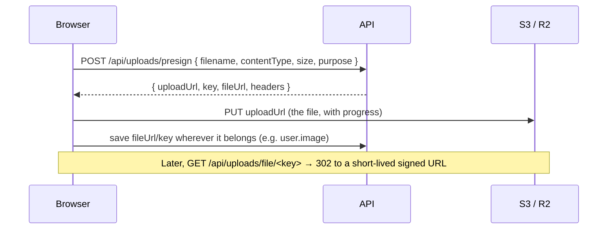

# File uploads

Files go **straight from the browser to S3-compatible storage**. The API only
signs URLs, so large files never touch your server.



- Request rules (size, content types, avatar limits) live in
  `packages/validators/src/uploads.ts`, shared by the API and the browser.
- `useFileUpload()` (`apps/web/src/features/uploads`) does presign + upload
  with progress. `AvatarUpload` on the profile page is the example.
- Buckets can stay **private**: files are read through
  `/api/uploads/file/<key>`, which redirects to a signed URL.

## Local development

`pnpm db:up` starts [RustFS](https://rustfs.com) (S3-compatible) on :9000,
console on :9001. The API creates the bucket on first boot.

## Production

**Cloudflare R2**

```
S3_ENDPOINT=https://<account-id>.r2.cloudflarestorage.com
S3_REGION=auto
S3_BUCKET=my-app-uploads
S3_ACCESS_KEY_ID=…
S3_SECRET_ACCESS_KEY=…
S3_FORCE_PATH_STYLE=false
```

**AWS S3:** leave `S3_ENDPOINT` empty and set the region.

Browsers upload directly to the bucket, so it needs a **CORS rule** allowing
`PUT` from your web origin with the `Content-Type` header:

```json
[{ "AllowedOrigins": ["https://app.example.com"], "AllowedMethods": ["PUT", "GET"], "AllowedHeaders": ["Content-Type"], "MaxAgeSeconds": 3600 }]
```
