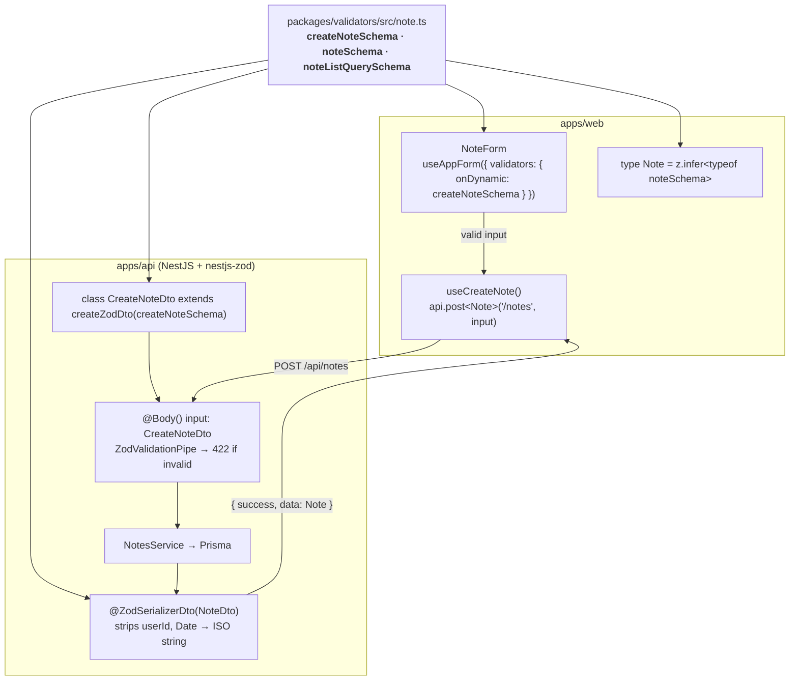
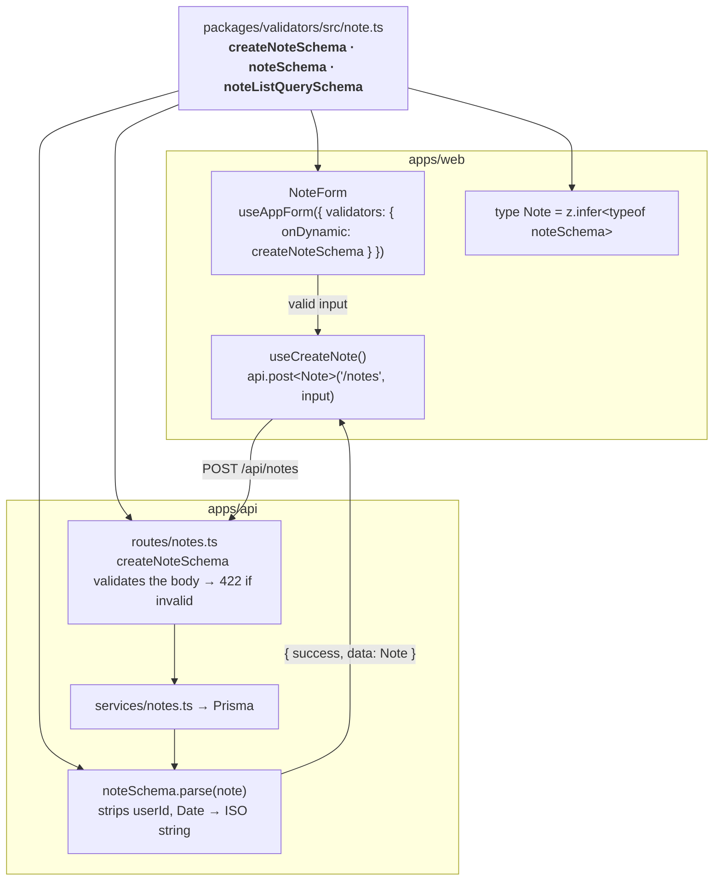

# How the shared validators flow

Every data shape is written **once**, as a Zod schema in
`packages/validators`, and used everywhere else: the API validates requests
and shapes responses with it, the web app validates its forms with it, and
both sides get their TypeScript types from it with `z.infer`. Here's the trip a
note takes:

<!-- klin:if nest -->

<!-- klin:else -->

<!-- klin:endif -->

## Why it matters

- **A rule changes in one place.** Make titles max 80 characters in
  `note.ts` and the form error, the API's 422 and the TypeScript types all
  update together.
- **The client can't drift from the server.** The form validates with the
  exact schema the API validates with, so a form that passes isn't rejected.
- **Responses are a contract.** Every response runs through a schema, so fields
  you didn't list (password hashes, owner ids) never leak, and the `Note` type
  the web app uses describes what it really receives.

## The schema file

```ts
// packages/validators/src/note.ts
const noteFields = { title: z.string().trim().min(1).max(120), … }

// Requests
export const createNoteSchema = z.object({ ...noteFields, pinned: noteFields.pinned.default(false) })
export const updateNoteSchema = z.object(noteFields).partial()   // PATCH: no defaults
export const noteListQuerySchema = listQuerySchema.extend({ … }) // ?page=2&search=…

// Responses
export const noteSchema = z.object({ id: idSchema, …, createdAt: isoDate() })
export const noteListSchema = paginatedSchema(noteSchema)

// Types — inferred, never written by hand
export type Note = z.infer<typeof noteSchema>                    // what the API returns
export type CreateNoteInput = z.input<typeof createNoteSchema>   // what a form holds
export type CreateNote = z.infer<typeof createNoteSchema>        // what the API receives
```

`z.infer` is the type *after* parsing (defaults applied, dates turned into
strings); `z.input` is what you may send *before* parsing — which is why forms
use `CreateNoteInput` (`pinned` optional) while the service gets `CreateNote`
(`pinned` always set).

Helpers in `common.ts` keep the edges tidy: `isoDate()` accepts a `Date` or
an ISO string and always outputs a string; `emptyToUndefined()` /
`emptyToNull()` turn empty form inputs into "not set" or "clear it";
`booleanish()` reads `?pinned=true` from query strings.

## On the web: forms and types

```tsx
// apps/web/src/features/notes/note-form.tsx
import { type CreateNoteInput, createNoteSchema, type Note } from "@repo/validators"

const form = useAppForm({
  defaultValues: { title: "", content: "", pinned: false } satisfies CreateNoteInput,
  validators: { onDynamic: createNoteSchema }, // the same rules the API enforces
  onSubmit: async ({ value }) => createNote.mutateAsync(value),
})
```

```ts
// apps/web/src/features/notes/api.ts — responses are typed with z.infer types
queryFn: ({ signal }) => api.get<NoteList>("/notes", query, signal)
```

If the API still rejects something (say, a unique constraint), its 422/409
`details` are mapped back onto the matching fields by `applyServerErrors`.

<!-- klin:if nest -->
## On the API: nestjs-zod DTOs

[nestjs-zod](https://github.com/BenLorantfy/nestjs-zod) turns each schema into
a DTO class. The class is the TypeScript type (`z.infer` of the schema) *and*
carries the schema for validation:

```ts
// apps/api/src/modules/notes/notes.dto.ts
import { createNoteSchema, noteSchema, … } from "@repo/validators"
import { createZodDto } from "nestjs-zod"

export class CreateNoteDto extends createZodDto(createNoteSchema) {}
export class NoteListQueryDto extends createZodDto(noteListQuerySchema) {}
export class NoteDto extends createZodDto(noteSchema) {}
```

```ts
// apps/api/src/modules/notes/notes.controller.ts
@Post()
@ZodSerializerDto(NoteDto)                        // response: shaped by noteSchema
create(@CurrentUser("id") userId: string, @Body() input: CreateNoteDto) {
  return this.notes.create(userId, input)          // input is z.infer<typeof createNoteSchema>
}
```

Two globals in `app.module.ts` make it work:

- `ZodValidationPipe` validates every `@Body()`, `@Query()` and `@Param()`
  typed with a Zod DTO. Failures throw `ZodValidationException`, which
  `ApiExceptionFilter` turns into `422 VALIDATION_ERROR` with per-field
  `details`.
- `ZodSerializerInterceptor` applies `@ZodSerializerDto(...)` to what the
  handler returns. A response that doesn't fit its schema is a server bug: it's
  logged and becomes a 500 (`ZodSerializationException`).

Paths of the issues (`["title"]`) become `field: "title"` through
`toValidationIssues()` from `@repo/validators`, the same shape the web form kit
reads.
<!-- klin:else -->
## On the API: parse at the edge

The plain API validates where requests come in and shapes data where responses
go out — no decorators, no DTO classes:

<!-- klin:if express -->
```ts
// apps/api/src/routes/notes.ts
notesRouter.post("/", async (req, res) => {
  const input = createNoteSchema.parse(req.body)            // z.infer<typeof createNoteSchema>
  const note = await notes.createNote(res.locals.auth.user.id, input)
  res.status(201).json(ok(req, noteSchema.parse(note)))     // strips userId, Date → ISO
})
```

A failed `parse()` throws a `ZodError`; Express 5 hands it to the error
middleware, which answers `422 VALIDATION_ERROR` with per-field `details`.
<!-- klin:else -->
```ts
// apps/api/src/routes/notes.ts
app.post("/", { schema: { body: createNoteSchema } }, async (request, reply) => {
  // request.body is z.infer<typeof createNoteSchema> — typed by the Zod type provider
  const note = await notes.createNote(request.auth.user.id, request.body)
  return reply.code(201).send(ok(request, noteSchema.parse(note)))
})
```

Route schemas are Zod schemas: `lib/zod.ts` plugs Zod into Fastify's
validation (a failure reaches the error handler as a `ZodError` → `422
VALIDATION_ERROR` with per-field `details`) and types `request.body`,
`request.query` and `request.params` from them.
<!-- klin:endif -->
<!-- klin:endif -->
