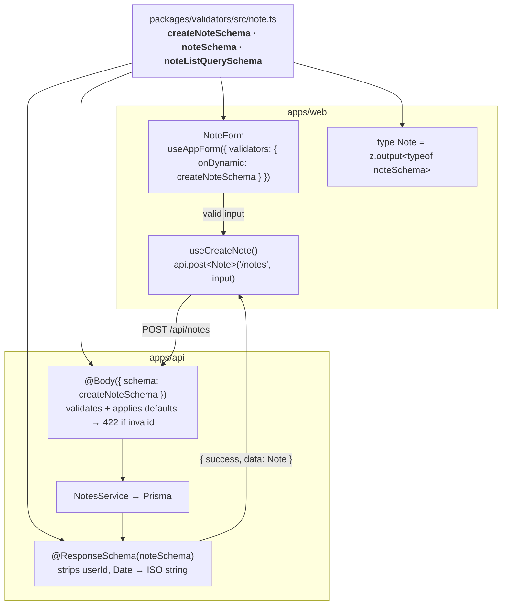

# How the shared validators flow

Every data shape is written **once**, as a Zod schema in
`packages/validators`, and used everywhere else. Here's the trip a note takes:



## Why it matters

- **A rule changes in one place.** Make titles max 80 characters in
  `note.ts` and the form error, the API's 422 and the TypeScript types all
  update together.
- **The client can't drift from the server.** The form validates with the
  exact schema the API validates with, so a form that passes isn't rejected.
- **Responses are a contract.** `@ResponseSchema` runs every response through
  a schema, so fields you didn't list (password hashes, owner ids) never leak,
  and the `Note` type the web app uses describes what it really receives.

## The pieces of a resource schema file

```ts
// Shared field rules
const noteFields = { title: z.string().trim().min(1).max(120), … }

// Requests
export const createNoteSchema = z.object({ ...noteFields, pinned: noteFields.pinned.default(false) })
export const updateNoteSchema = z.object(noteFields).partial()   // PATCH: no defaults
export const noteListQuerySchema = listQuerySchema.extend({ … }) // ?page=2&search=…

// Responses
export const noteSchema = z.object({ id: idSchema, …, createdAt: isoDate() })
export const noteListSchema = paginatedSchema(noteSchema)

// Types
export type Note = z.output<typeof noteSchema>
export type CreateNoteInput = z.input<typeof createNoteSchema>  // what a form holds
export type CreateNote = z.output<typeof createNoteSchema>      // what the API receives
```

Helpers in `common.ts` keep the edges tidy: `isoDate()` accepts a `Date` or
an ISO string and always outputs a string; `emptyToUndefined()` /
`emptyToNull()` turn empty form inputs into "not set" or "clear it";
`booleanish()` reads `?pinned=true` from query strings.

## Nest + Zod without DTO classes

NestJS 12 understands [Standard Schema](https://standardschema.dev), which Zod
implements. Pass the schema straight to the parameter decorator:

```ts
@Post()
@ResponseSchema(noteSchema)
create(@CurrentUser("id") userId: string, @Body({ schema: createNoteSchema }) input: CreateNote) {
  return this.notes.create(userId, input)
}
```

The global `SchemaValidationPipe` validates it, and the global serializer
applies `@ResponseSchema`. No class mirrors, no decorators on every field.
